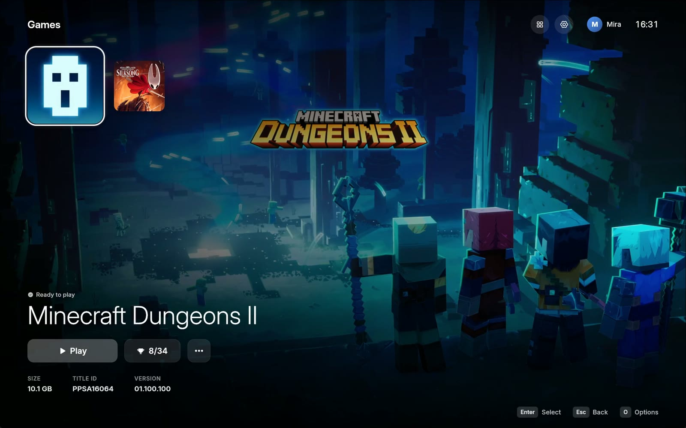
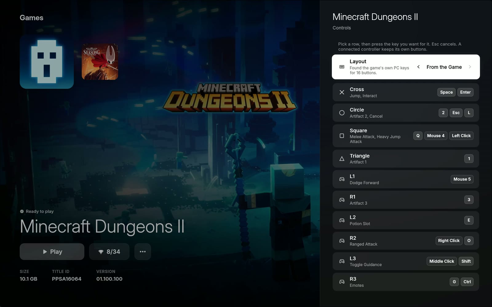
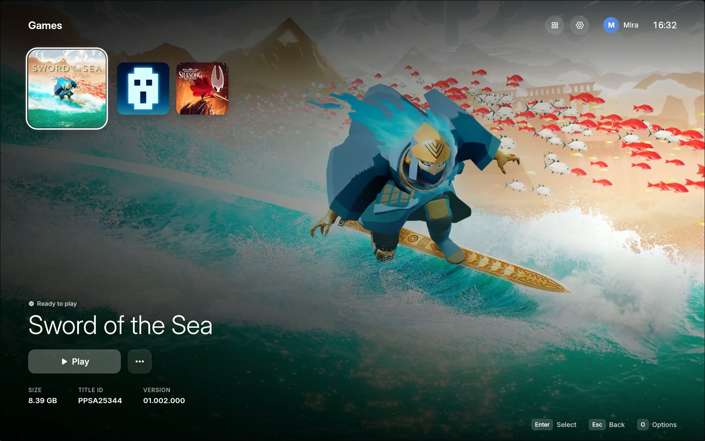
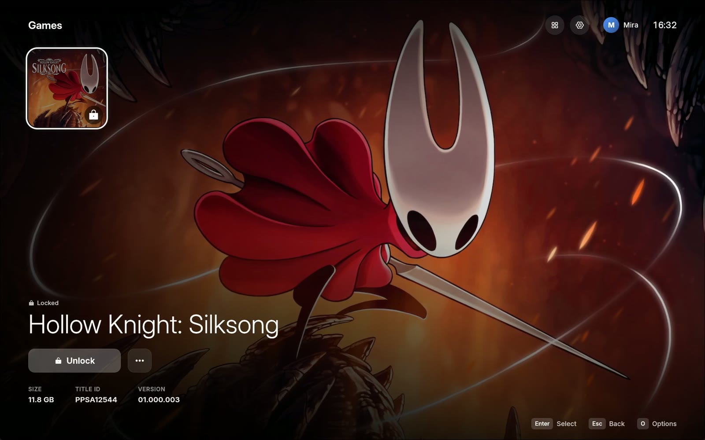

# AnyPlay Launcher

The home of your games on PC. The launcher finds the games you dumped from your own console, unlocks them with [AnyPS5](https://github.com/boykopovar/AnyPS5) and starts them from a console-style home screen, on Windows and Linux.

It is part of **[AnyPlay](https://github.com/anyplay-gg)**, which builds everything around AnyPS5 that players need:

| | |
|---|---|
| **Launcher** (this repository) | Your library: unlock, play, controls, trophies and saves |
| **[Network](https://github.com/anyplay-gg/network)** | Online play with friends over the internet, in development |
| **[Cloud](https://github.com/anyplay-gg/cloud)** | The services behind the network, run by AnyPlay or by you |

<p align="center">
  
</p>

<p align="center"><a href="https://github.com/anyplay-gg/launcher/releases/download/v0.1.0/AnyPS5-Launcher-Update.mp4"><b>Watch the update video with sound</b></a></p>

| | |
|---|---|
|  |  |
|  |  |

<sub>Game artwork belongs to its publishers and is shown only to illustrate the launcher.</sub>

## What it does

- **A home screen for your games.** Each game shows its own artwork and music, the launcher fades in with soft system sounds, and it runs fullscreen like a console (F11 for a window).
- **Unlock and play in one place.** The launcher turns a dump into a game AnyPS5 can run and starts it. It downloads the AnyPS5 toolkit on the first start and keeps it up to date.
- **Controls that match the game.** It reads a game's controls from its own files (Unreal Engine, including Enhanced Input), so every button shows what it does, and one choice gives you the game's own PC keys. Ready-made mouse and keyboard layouts are there too.
- **Trophies, saves and playtime.** Trophies pop up while you play, save data is backed up before anything risky, and the home screen shows how long you played.
- **Online with friends.** Sign in to the AnyPlay network, see what your friends play and join their game. This part is in development; see [Online play](#online-play).
- **Links and folders.** `anyps5://game/<title ID>` links open a game from a website or a message, and folders get "Open with AnyPS5" ([docs/DESIGN.md](docs/DESIGN.md) 9.6).

## Download

Get the latest version from the [releases page](https://github.com/anyplay-gg/launcher/releases/latest). The release files still carry the name AnyPS5 Launcher.

**Windows** (64-bit Windows 10 or 11, nothing else to install first):

- **`AnyPS5-Launcher-<version>-Setup.exe`** installs the launcher for your user account, without administrator rights. It adds a Start menu entry, an optional desktop shortcut and an uninstaller.
- **`AnyPS5-Launcher-<version>-x64.exe`** is the same launcher as a single file. Put it anywhere and run it.

The files are not code-signed yet, so SmartScreen may say "Windows protected your PC". Click **More info**, then **Run anyway**; it asks once per file. Each release lists SHA-256 checksums in `SHA256SUMS.txt`: run `Get-FileHash <file>` in PowerShell and compare.

**Linux** (64-bit x86-64 with glibc 2.35 or newer, such as Ubuntu 22.04, Debian 12 or Fedora 36, a Vulkan driver, and the ALSA and udev libraries every desktop has):

- **`AnyPS5-Launcher-<version>-x86_64.AppImage`**: make it executable and run it. Without FUSE 2, add `--appimage-extract-and-run`.

  ```sh
  chmod +x AnyPS5-Launcher-*-x86_64.AppImage
  ./AnyPS5-Launcher-*-x86_64.AppImage
  ```

- **`AnyPS5-Launcher-<version>-linux-x86_64.tar.gz`** holds the executable, a `.desktop` file and the icon. Unpack it anywhere; copy the `.desktop` file to `~/.local/share/applications` and the icon to `~/.local/share/icons` for a menu entry.

The Linux build is new, and it does not update itself yet: download a new version from the releases page. What games need from your system is up to AnyPS5:

- a CPU with AVX2, FMA, F16C, BMI1, BMI2, LZCNT and MOVBE (Zen 2, Intel Haswell or newer);
- a Vulkan 1.1 GPU. With Mesa drivers (AMD, Intel) games import memory through `/dev/udmabuf`: join the `kvm` group (`sudo usermod -aG kvm $USER`) and log in again. The launcher tells you when a game fails for this reason;
- on Wayland a game's window cannot be found or placed from outside, so the launcher counts a game as shown after a few seconds, and fullscreen and size follow the game's own settings (F11 in the game).

## First start

1. Choose a language and a look.
2. Pick your games folder, the one that holds your decrypted dumps. The launcher lists what it finds there.
3. The launcher downloads the AnyPS5 toolkit and tells you when it is ready. Without internet, open Settings later and choose *Download the Toolkit*.
4. Select a game, unlock it and press Play.

The launcher updates itself on Windows: it looks for a new release when it starts, downloads and checks it in the background, and installs it when you close the launcher (or at once with *Restart Now* in Settings, About). Turn *Check for Updates* off in Settings to stop that.

Settings live in `%APPDATA%\AnyPS5` and the toolkit, logs and caches in `%LOCALAPPDATA%\AnyPS5` (Linux: `~/.config/anyps5` and `~/.local/share/anyps5`, or where `XDG_CONFIG_HOME` and `XDG_DATA_HOME` point). Uninstalling leaves them in place.

## Online play

Select your profile at the top of the home screen to open **Online**. Sign in with your e-mail address: there is no password, each PC gets a code by e-mail. Then add friends by their name, see what they play and join their game when it is open to friends.

- The launcher contacts the network only after you sign in. Until then, nothing goes online.
- By default you sign in to the cloud AnyPlay runs, once it is open. Under **Online → Cloud** you can use a cloud of your own or of friends instead; [anyplay-gg/cloud](https://github.com/anyplay-gg/cloud) explains how to host one.
- A game plays online only with an AnyPS5 build that carries the network bridge and when its online part uses the platform's own services. Games that need a publisher's servers stay offline. The [network's design](https://github.com/anyplay-gg/network/blob/main/docs/DESIGN.md) has the details and the roadmap.
- *Record Network Calls* (Settings, Advanced) makes a game write what it asks the network for into the Logs folder. It helps bring games online, and nothing is uploaded.

The network is in development. Friends and presence come first; playing together follows game by game.

## Building

The launcher is written in Rust (eframe and egui on wgpu). You need a stable Rust toolchain, 1.88 or newer ([rustup](https://rustup.rs)), and a clone of [anyplay-gg/network](https://github.com/anyplay-gg/network) next to this repository for the online crates.

```sh
cargo fmt --all -- --check
cargo clippy --workspace --all-targets -- -D warnings
cargo test --workspace
cargo build --release
```

The executable is `target/release/anyps5-launcher.exe` (Linux: `target/release/anyps5-launcher`). For online play it looks for the net service `anyplay-net` next to itself, or where `ANYPLAY_NET` points; build it in the network repository with `cargo build --release -p anyplay-net`. A build names AnyPlay's own cloud with `ANYPLAY_DEFAULT_CLOUD`; without it the player enters a cloud.

On Linux, install the development packages first (Debian and Ubuntu names: `pkg-config libasound2-dev libudev-dev libxkbcommon-dev libwayland-dev libxcb-render0-dev libxcb-shape0-dev libxcb-xfixes0-dev`). `tools/linux/package.sh <version> <binary> <folder>` makes the AppImage and the tarball.

Two toolchains are used on Windows:

- **MSVC** (`x86_64-pc-windows-msvc`, needs the Visual Studio Build Tools) is what CI builds and releases ship. `.cargo/config.toml` links the C runtime statically, so the exe needs no Visual C++ redistributable.
- **GNU** (`x86_64-pc-windows-gnu`) works for local development without Visual Studio. If the linker fails, build with `RUSTFLAGS="-C link-self-contained=yes -C linker=rust-lld -C linker-flavor=ld.lld"` and make `libshlwapi.a` (from any MinGW-w64) available through an extra `-L native=<dir>`. Do not build in a path that contains an apostrophe: `windres` cannot embed the icon there.

A release is made by pushing a tag `v<version>` that matches the version in `Cargo.toml`. The [release workflow](.github/workflows/release.yml) builds the portable exe and the installer (`tools/installer/anyps5-launcher.iss`, Inno Setup) and publishes both with their checksums. Started by hand it only builds them and keeps them as workflow artifacts.

`crates/anyps5-core` holds all logic without UI; `crates/anyps5-launcher` is the application. The interface is specified in [docs/DESIGN.md](docs/DESIGN.md), the logic in [docs/PORT.md](docs/PORT.md) and the words in [CONTEXT.md](CONTEXT.md).

## Credits and licence

Licensed under GPL-2.0 (see [LICENSE](LICENSE)).

The launcher began as a port of the macOS launcher by [utkuhalis](https://github.com/utkuhalis) in [AnyPS5-ARM](https://github.com/utkuhalis/AnyPS5-ARM) (GPL-2.0), whose design and logic it builds on. Since then it has its own implementation, Windows and Linux integration, the online area and much more.

Bundled fonts and icons (licence texts in `crates/anyps5-launcher/assets/fonts/`): [Inter](https://rsms.me/inter/) (SIL OFL 1.1), [JetBrains Mono](https://www.jetbrains.com/lp/mono/) (SIL OFL 1.1) and [Phosphor Icons](https://phosphoricons.com) (MIT).

## Legal note

- You need your own decrypted game dumps. No game files, keys or firmware are included in this repository, and none will be.
- AnyPS5 is not an emulator: it ports executables so they run natively. The launcher manages and starts them.
- AnyPlay is a community project. It is not affiliated with Sony Interactive Entertainment or with the AnyPS5 maintainers. "PlayStation" and "PS5" are trademarks of Sony Interactive Entertainment.
